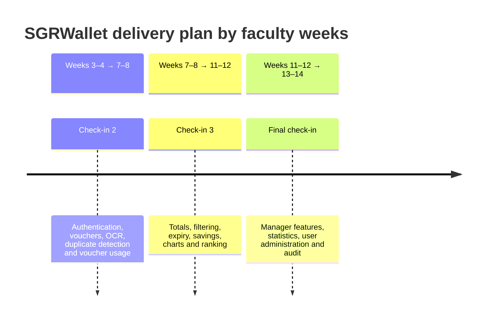

# Project Planning and Requirements Traceability

## Scope

This document combines the project Gantt plan and the requirements traceability
matrix required by Section 8. The current status is synchronized with the
`[SGRWallet] Sprint 1` YouTrack board.

The Gantt uses faculty-week intervals rather than calendar dates. YouTrack
remains the source of truth for the current issue status, assignee and sprint
membership.

## Sprint Goal

Deliver the complete SGRWallet flow: user authentication and administration,
voucher collection and processing, duplicate prevention, amount calculation and
reporting, manager features, and administrative auditing.

## Gantt Plan

### Work package breakdown

| Work package | Faculty weeks | Main User Stories |
|---|---|---|
| Check-in 2 | 3–4 through 7–8 | US-01A, US-01B, US-04, US-16, US-05A, US-05B, US-08 |
| Check-in 3 | 7–8 through 11–12 | US-06, US-07, US-09, US-12A, US-12B, US-13 |
| Final check-in | 11–12 through 13–14 | US-02, US-03, US-14A, US-15A, US-15B |

### Planning assumptions

- Check-in 2 is the current implementation baseline; its YouTrack issues are
  currently `Fixed`.
- Check-in 3 and the final check-in remain in the sprint backlog and are
  currently `Open` in YouTrack.
- The intervals represent the faculty schedule, not recorded work logs.
- Dependencies are logical delivery dependencies, not YouTrack issue links.

## Requirements Traceability Matrix

Status values below reflect the current YouTrack state and the current
repository. `Partial` means that supporting code exists but the complete User
Story is not yet demonstrated as finished.

| Requirement | User Story / YouTrack | MoSCoW | Current status | Implementation | Tests / evidence |
|---|---|---:|---|---|---|
| Account registration | US-01A / `SGR-1` | Must | Fixed | [`AuthController`](src/main/java/ro/mops/sgrwallet/controller/AuthController.java), [`AuthService`](src/main/java/ro/mops/sgrwallet/service/AuthService.java), [`User`](src/main/java/ro/mops/sgrwallet/model/User.java) | [`AuthServiceTest`](src/test/java/ro/mops/sgrwallet/service/AuthServiceTest.java), [`AuthControllerTest`](src/test/java/ro/mops/sgrwallet/controller/AuthControllerTest.java) |
| Authentication | US-01B / `SGR-2` | Must | Fixed | [`AuthController`](src/main/java/ro/mops/sgrwallet/controller/AuthController.java), [`AuthService`](src/main/java/ro/mops/sgrwallet/service/AuthService.java), [`SecurityConfig`](src/main/java/ro/mops/sgrwallet/config/SecurityConfig.java) | [`AuthServiceTest`](src/test/java/ro/mops/sgrwallet/service/AuthServiceTest.java), [`AuthControllerTest`](src/test/java/ro/mops/sgrwallet/controller/AuthControllerTest.java) |
| Manual voucher entry | US-04 / `SGR-3` | Must | Fixed | [`VoucherController`](src/main/java/ro/mops/sgrwallet/controller/VoucherController.java), [`VoucherService`](src/main/java/ro/mops/sgrwallet/service/VoucherService.java), [`Voucher`](src/main/java/ro/mops/sgrwallet/model/Voucher.java) | [`VoucherServiceTest`](src/test/java/ro/mops/sgrwallet/service/VoucherServiceTest.java), [`VoucherControllerTest`](src/test/java/ro/mops/sgrwallet/controller/VoucherControllerTest.java) |
| Duplicate voucher detection | US-16 / `SGR-4` | Must | Fixed | [`VoucherService`](src/main/java/ro/mops/sgrwallet/service/VoucherService.java), [`VoucherRepository`](src/main/java/ro/mops/sgrwallet/repository/VoucherRepository.java), [`DuplicateVoucherException`](src/main/java/ro/mops/sgrwallet/exception/DuplicateVoucherException.java) | [`VoucherServiceTest`](src/test/java/ro/mops/sgrwallet/service/VoucherServiceTest.java#L308), [`VoucherControllerTest`](src/test/java/ro/mops/sgrwallet/controller/VoucherControllerTest.java#L114) |
| Voucher photo and OCR | US-05A / `SGR-5` | Must | Fixed | [`DashboardPage`](frontend/src/pages/DashboardPage.jsx), [`ocr-service/app`](ocr-service/app), [`api.js`](frontend/src/services/api.js) | [`DashboardPage.test.jsx`](frontend/src/pages/DashboardPage.test.jsx), [`test_extractor.py`](ocr-service/tests/test_extractor.py), [`test_api.py`](ocr-service/tests/test_api.py) |
| OCR data confirmation | US-05B / `SGR-6` | Must | Fixed | [`DashboardPage`](frontend/src/pages/DashboardPage.jsx) | [`DashboardPage.test.jsx`](frontend/src/pages/DashboardPage.test.jsx) |
| Barcode and used voucher state | US-08 / `SGR-7` | Must | Fixed | [`VoucherList`](frontend/src/components/VoucherList.jsx), [`DashboardPage`](frontend/src/pages/DashboardPage.jsx), [`VoucherService`](src/main/java/ro/mops/sgrwallet/service/VoucherService.java) | [`VoucherServiceTest`](src/test/java/ro/mops/sgrwallet/service/VoucherServiceTest.java), [`VoucherControllerTest`](src/test/java/ro/mops/sgrwallet/controller/VoucherControllerTest.java), [`DashboardPage.test.jsx`](frontend/src/pages/DashboardPage.test.jsx) |
| Totals by store | US-06 / `SGR-8` | Must | Open | Planned | Tests not implemented |
| Filtered and sorted voucher list | US-07 / `SGR-9` | Must | Open | Planned | Tests not implemented |
| Automatic expiry | US-09 / `SGR-10` | Must | Open | Expiry calculation exists in [`DashboardPage`](frontend/src/pages/DashboardPage.jsx); complete story remains open | Date validation in [`VoucherServiceTest`](src/test/java/ro/mops/sgrwallet/service/VoucherServiceTest.java); dedicated story test still needed |
| Total savings | US-12A / `SGR-11` | Should | Open | Planned | Tests not implemented |
| Monthly chart | US-12B / `SGR-12` | Could | Open | Planned | Tests not implemented |
| Monthly ranking | US-13 / `SGR-13` | Could | Open | Planned | Tests not implemented |
| Manager account request | US-02 / `SGR-14` | Should | Open | Planned | Tests not implemented |
| Store account approval | US-03 / `SGR-15` | Should | Open | Planned | Tests not implemented |
| Manager statistics | US-14A / `SGR-16` | Should | Open | Planned | Tests not implemented |
| Block or delete users | US-15A / `SGR-17` | Should | Open | Planned | Tests not implemented |
| Administrative action history | US-15B / `SGR-18` | Could | Open | [`AuditLog`](src/main/java/ro/mops/sgrwallet/model/AuditLog.java) exists; complete story and automatic logging remain planned | Tests not implemented |

## Current YouTrack Snapshot

- Sprint: `Sprint 1 (SGR Wallet)`
- Board: `[SGRWallet] Sprint 1`
- Sprint issues: 18
- `Fixed`: 7 issues (`SGR-1` to `SGR-7`)
- `Open`: 11 issues (`SGR-8` to `SGR-18`)
- `In Progress`, `Testing`, `Code Review`: no issues currently

## Traceability Maintenance

When a User Story changes in YouTrack:

1. Update its state and assignee in YouTrack first.
2. Update the corresponding row in this matrix.
3. Add or update links to the implementation and test files.
4. Move the issue through `Open → In Progress → Testing → Code Review → Fixed`
   on the agile board.
